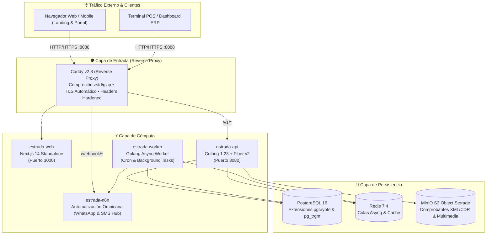

# 🚗 Lubricentros Estrada — Ecosistema Digital Cloud-Native v2.0

[](https://golang.org)
[](https://nextjs.org)
[](https://www.postgresql.org)
[](https://redis.io)
[](https://www.docker.com)
[](#licencia)

> **Plataforma Integral de Gestión Automotriz, Terminal POS de Alta Velocidad, Facturación Electrónica SUNAT UBL 2.1 y Portal de Autoservicio para Clientes.**  
> Diseñado bajo arquitectura de microservicios contenerizada con Docker, núcleo transaccional en Golang y frontend de alta fidelidad en Next.js App Router.

---

## 📑 Tabla de Contenidos

1. [Visión General del Sistema](#-visión-general-del-sistema)
2. [Arquitectura de Microservicios](#-arquitectura-de-microservicios)
3. [Módulos Principales](#-módulos-principales)
4. [Stack Tecnológico](#-stack-tecnológico)
5. [Estructura del Proyecto](#-estructura-del-proyecto)
6. [Instalación y Despliegue Local](#-instalación-y-despliegue-local)
7. [Base de Datos y Migraciones](#-base-de-datos-y-migraciones)
8. [Variables de Entorno](#-variables-de-entorno)
9. [Credenciales de Demostración](#-credenciales-de-demostración)
10. [Catálogo de Endpoints API](#-catálogo-de-endpoints-api)
11. [Buenas Prácticas y Flujo Git](#-buenas-prácticas-y-flujo-git)
12. [Licencia](#-licencia)

---

## 🌟 Visión General del Sistema

**Lubricentros Estrada S.A.C.** (RUC: `20608945123`) es una solución integral diseñada para modernizar y acelerar las operaciones comerciales y de taller en el rubro de lubricación y mantenimiento automotriz en Perú. El sistema resuelve tres pilares fundamentales:

1. **Atención Comercial & POS:** Cobro y emisión de comprobantes en menos de 100 ms en punto de venta, con soporte offline/resiliente y vista adaptada para teléfonos móviles.
2. **Autoservicio para Clientes:** Consulta autónoma de historial de mantenimientos, estado del lubricante, kilometraje actual vs. próximo cambio recomendado e historial de facturas.
3. **Control y Analítica Administrativa:** ERP integral con control de inventario Kardex, gestión de categorías, CRM predictivo con cálculo de alertas de servicio y panel de control con métricas en tiempo real.

---

## 🏗 Arquitectura de Microservicios

Toda la infraestructura se encuentra 100% contenerizada en Docker, aislada en redes internas para garantizar que los almacenes de datos (PostgreSQL, Redis) no queden expuestos directamente al tráfico público.



---

## 📦 Módulos Principales

### 1. Landing Page Premium & Catálogo Interactivo
* **Cinemática Automotriz:** Video de fondo optimizado, carrusel infinito de marcas automotrices (Toyota, BMW, Audi, Mercedes-Benz, Hyundai, Chevrolet, Porsche, Ford, etc.).
* **Geolocalización Mapbox:** Ubicación interactiva en mapa satelital del taller principal (`WQQ9+7JR`).
* **Catálogo de Lubricantes:** Filtrado instantáneo por viscosidad (`0W-20`, `5W-30`, `10W-40`, `20W-50`), tipo de base (100% Sintético, Semisintético, Mineral) y especificaciones técnicas.
* **Modal de Producto:** Vista detallada de especificaciones técnicas (API SP/SN, ILSAC GF-6, normas OEM y ficha de seguridad).
* **Cumplimiento Legal:** Módulos de Libro de Reclamaciones virtual, Términos y Condiciones y Configuración de Cookies.

### 2. Portal de Autoservicio para Clientes
* **Autenticación Directa:** Acceso mediante la **placa del vehículo** (ej. `ABC-123`) y contraseña personal cifrada con `bcrypt`.
* **Registro Autónomo:** Permite a clientes nuevos afiliar su vehículo y registrar su número de WhatsApp de contacto.
* **Historial de Servicios:** Consulta de fechas, kilometrajes registrados, tipo de aceite aplicado, filtros cambiados y comprobante emitido.
* **Mantenimiento Predictivo:** Barra de salud del aceite que calcula el porcentaje de vida útil restante y los kilómetros faltantes para el próximo cambio.

### 3. ERP Administrativo & Terminal POS
* **Dashboard Analítico:** Panel en tiempo real construido con **Recharts** que muestra total facturado en el mes, comprobantes emitidos, porcentaje de aceptación con CDR ante SUNAT y alertas de inventario.
* **Terminal POS Móvil:** Búsqueda rápida de productos por SKU/nombre, selección de clientes frecuentes desde el CRM, emisión de Boletas/Facturas con cálculo estricto de IGV (18%) y barra de carrito inferior adaptada para smartphones (*Sticky Cart Pill*).
* **Gestión de Comprobantes:** Visualización y descarga de comprobantes electrónicos, estado de envío a SUNAT y detalle de ítems.
* **Catálogo de Productos & Categorías:** CRUD completo con soporte de carga de imágenes, especificaciones técnicas en JSONB y control de stock mínimo.
* **Kardex de Inventario:** Registro auditable de entradas, salidas y mermas con cálculo de costo unitario ponderado.
* **CRM de Fidelización:** Directorio de clientes y vehículos con semáforo de estado de mantenimiento (`OPTIMAL`, `DUE_SOON`, `OVERDUE`) y botón directo para recordatorio por WhatsApp.

---

## 🛠 Stack Tecnológico

| Capa | Tecnología | Propósito |
| :--- | :--- | :--- |
| **Backend Core** | Go (Golang 1.23) + Fiber v2 | API RESTful de latencia sub-milisegundo y alta concurrencia |
| **Driver BD** | `pgx/v5` (`pgxpool`) | Pool de conexiones nativas y tipadas hacia PostgreSQL |
| **Seguridad** | `bcrypt` + `golang-jwt/v5` | Cifrado seguro de contraseñas y tokens JWT para administradores y portal |
| **Precisión SUNAT** | `shopspring/decimal` | Aritmética de punto fijo para cálculos fiscales sin desbordamiento |
| **Colas de Tareas** | `hibiken/asynq` + Redis | Procesamiento asíncrono de recordatorios, generación de PDFs y webhooks |
| **Frontend** | Next.js 14 + TypeScript | Server-Side Rendering y compilación standalone optimizada |
| **Diseño & UI** | Tailwind CSS + Lucide Icons | Interfaz moderna con temas oscuros de contraste alto y microinteracciones |
| **Gráficos** | Recharts | Gráficos vectoriales responsivos de ventas y facturación diaria |
| **Proxy Inverso** | Caddy v2.8 (Alpine) | Enrutamiento perimetral, compresión zstd/gzip y cabeceras de seguridad |
| **Base de Datos** | PostgreSQL 16 (Alpine) | Motor relacional con extensiones `pgcrypto` y `pg_trgm` |
| **Cache & Broker** | Redis 7.4 (Alpine) | Cache en memoria y almacenamiento intermedio de colas Asynq |
| **Almacenamiento** | MinIO (Compatible S3) | Repositorio de comprobantes XML, CDRs y recursos multimedia |

---

## 📁 Estructura del Proyecto

```text
Lubricentro_Estrada/
├── .github/
│   └── workflows/
│       └── ci.yml               # Pipeline de integración continua (Go + Next.js + Docker)
├── assets/                      # Material gráfico, logotipos de marcas y videos
├── backend/                     # Microservicio API & Worker en Golang
│   ├── cmd/
│   │   ├── api/                 # Punto de entrada de la API HTTP (Fiber)
│   │   └── worker/              # Punto de entrada de tareas en segundo plano (Asynq)
│   ├── internal/
│   │   ├── config/              # Carga de variables de entorno tipadas
│   │   ├── delivery/http/       # Handlers HTTP, controladores y rutas REST
│   │   ├── domain/              # Modelos de dominio, interfaces y entidades
│   │   ├── repository/          # Capa de acceso a datos con pgxpool
│   │   ├── security/            # Hashing bcrypt y generación/validación de JWT
│   │   ├── service/             # Lógica de negocio (ventas, cálculos, SUNAT)
│   │   └── worker/              # Definición de tareas asíncronas y cron
│   ├── migrations/              # Scripts de migración SQL versionados (001 a 004)
│   ├── pkg/                     # Utilidades compartidas (logger, respuestas HTTP)
│   ├── Dockerfile               # Multi-stage build para Go (binario estático)
│   ├── go.mod                   # Definición de dependencias Go
│   └── go.sum
├── docker/                      # Configuraciones de servicios de infraestructura
│   ├── caddy/                   # Caddyfile con reglas de proxy inverso y seguridad
│   └── postgres/                # Scripts de inicialización de base de datos
├── docs/                        # Documentación complementaria y guías de arquitectura
├── frontend/                    # Aplicación Web & ERP en Next.js 14
│   ├── public/                  # Recursos estáticos (videos, imágenes, marcas)
│   ├── src/
│   │   ├── app/                 # Rutas de App Router (Landing, Admin, Portal)
│   │   ├── components/          # Componentes reutilizables (UI, Layouts, Modales)
│   │   └── lib/                 # Cliente API y utilidades
│   ├── Dockerfile               # Build multi-stage para Next.js Standalone
│   ├── package.json
│   └── tailwind.config.ts
├── scripts/                     # Scripts de automatización operativa (PowerShell/Bash)
│   └── manage.ps1               # CLI de control rápido del entorno Docker
├── .dockerignore
├── .env.example                 # Plantilla oficial de variables de entorno
├── .gitattributes
├── .gitignore                   # Configuración de exclusiones de Git
├── docker-compose.yml           # Orquestación multicontenedor completa
├── Makefile                     # Atajos de terminal estándar para compilación y pruebas
└── README.md                    # Documentación principal del sistema
```

---

## 🚀 Instalación y Despliegue Local

### Requisitos Previos
* **Docker Desktop** (con soporte Docker Compose v2+)
* **Git** 2.40+
* *(Opcional)* Node.js 20+ y Go 1.23+ si se desea desarrollo nativo sin Docker.

### Paso a Paso para Iniciar el Ecosistema

1. **Clonar el repositorio:**
   ```bash
   git clone https://github.com/josebacilio2004/estrada_lubricentro.git
   cd estrada_lubricentro
   ```

2. **Configurar las variables de entorno:**
   ```bash
   cp .env.example .env
   ```

3. **Construir y levantar los contenedores con Docker Compose:**
   ```bash
   docker compose up -d --build
   ```

4. **Verificar el estado de los servicios:**
   ```bash
   docker compose ps
   ```

5. **Acceder a los módulos del sistema:**
   * **Portal Web & Landing:** [http://localhost:8088](http://localhost:8088)
   * **Portal de Clientes:** [http://localhost:8088/portal](http://localhost:8088/portal)
   * **ERP Administrativo:** [http://localhost:8088/admin/login](http://localhost:8088/admin/login)
   * **Terminal de Ventas POS:** [http://localhost:8088/admin/pos](http://localhost:8088/admin/pos)
   * **API Core Health Check:** [http://localhost:8088/v1/health](http://localhost:8088/v1/health)

---

## 🗄 Base de Datos y Migraciones

Las migraciones de esquema se ejecutan en orden secuencial mediante archivos SQL versionados:

* `001_init_schema.up.sql`: Estructura base relacional (categorías, productos, inventario, clientes, vehículos, servicios y comprobantes SUNAT).
* `002_seed_sample_data.up.sql`: Catálogo semilla con lubricantes sintéticos, filtros y clientes iniciales.
* `003_portal_and_products.up.sql`: Ampliación del esquema para el portal de clientes, especificaciones técnicas avanzadas y registro de vehículos.
* `004_security_and_erp_users.up.sql`: Creación de la tabla `users` con autenticación RBAC, hashing `bcrypt` de contraseñas de clientes/administradores e índices de alto rendimiento para búsquedas trigram (`gin_trgm_ops`).

Para aplicar manualmente las migraciones o reiniciar datos:
```powershell
Get-Content backend/migrations/004_security_and_erp_users.up.sql | docker exec -i estrada_postgres psql -U estrada_admin -d lubricentro_estrada
```

---

## 🔑 Credenciales de Demostración

| Entorno | Identificador / Usuario | Contraseña | Rol / Permisos |
| :--- | :--- | :--- | :--- |
| **Administración ERP & POS** | `admin@estrada.pe` | `admin123` | Administrador General (RUC 20608945123) |
| **Portal de Clientes** | Placa: `ABC-123` | `estrada123` | Propietario (Toyota RAV4) |
| **Portal de Clientes (Flota)** | Placa: `BCX-456` | `estrada123` | Empresa de Transportes (Nissan Frontier) |
| **Base de Datos PostgreSQL** | `estrada_admin` | `EstradaSecret2026!` | Superusuario (`lubricentro_estrada`) |
| **Redis** | Sin contraseña en red interna | — | Almacén de colas |
| **MinIO Storage** | `estrada_s3_admin` | `EstradaS3Secret2026!` | Administración de buckets |

---

## 📡 Catálogo de Endpoints API

Todas las peticiones a la API responden bajo el formato estándar JSON:
```json
{
  "success": true,
  "data": { ... },
  "timestamp": "2026-11-15T10:48:50Z"
}
```

### Endpoints Principales

| Método | Ruta | Descripción | Autenticación |
| :--- | :--- | :--- | :--- |
| `GET` | `/v1/health` | Estado de salud y uptime de la API | Pública |
| `POST` | `/v1/admin/auth/login` | Login administrativo ERP con emisión de JWT | Pública |
| `POST` | `/v1/portal/auth/login` | Login de clientes por Placa vehicular | Pública |
| `POST` | `/v1/portal/auth/register` | Registro de nuevos clientes y vehículos | Pública |
| `GET` | `/v1/products` | Catálogo completo de productos con filtros | Pública / Admin |
| `POST` | `/v1/products` | Creación de nuevo producto en catálogo | Admin (JWT) |
| `GET` | `/v1/categories` | Listado de categorías y conteo de productos | Pública / Admin |
| `POST` | `/v1/categories` | Creación de nueva categoría | Admin (JWT) |
| `POST` | `/v1/sales` | Registro de venta POS y emisión electrónica | Cajero / Admin |
| `GET` | `/v1/sales` | Historial de comprobantes emitidos | Admin (JWT) |
| `GET` | `/v1/customers` | Directorio de clientes CRM | Admin (JWT) |
| `POST` | `/v1/customers` | Creación y actualización de clientes | Admin (JWT) |
| `GET` | `/v1/inventory/movements` | Historial de movimientos de Kardex | Admin (JWT) |
| `GET` | `/v1/analytics/dashboard` | Métricas y gráfico de facturación diaria | Admin (JWT) |

---

## 🌿 Buenas Prácticas y Flujo Git

El proyecto sigue una estrategia basada en **Git Flow** adaptada para despliegues continuos:

### Estructura de Ramas
* `main`: Código en producción, estable y auditado. Solo recibe merges verificados desde `develop` o ramas `hotfix/*`.
* `develop`: Rama principal de integración y desarrollo. Aquí convergen todas las características probadas antes del release.
* `feature/<nombre-tarea>`: Ramas de corta duración para nuevas funcionalidades, creadas a partir de `develop`.
* `bugfix/<nombre-error>`: Ramas para corrección de incidencias detectadas en desarrollo.
* `hotfix/<urgente>`: Correcciones críticas directas hacia `main` con posterior sincronización a `develop`.

### Convención de Commits (Conventional Commits)
Cada commit debe explicar claramente el propósito del cambio usando prefijos estándar:
* `feat:` Nueva funcionalidad para el usuario o sistema.
* `fix:` Corrección de un fallo o vulnerabilidad.
* `docs:` Cambios o adiciones en documentación.
* `style:` Formato, espacios, punto y coma, sin impacto en la lógica.
* `refactor:` Reestructuración de código sin alterar su comportamiento externo.
* `perf:` Mejoras de rendimiento o reducción de tiempos de respuesta.
* `test:` Adición o actualización de pruebas automatizadas.
* `chore:` Mantenimiento de herramientas, scripts o configuración de dependencias.
* `ci:` Modificaciones en pipelines de CI/CD (GitHub Actions).

Ejemplo:
```bash
git commit -m "feat(pos): implementar sticky cart bar para dispositivos móviles"
```

---

## 📄 Licencia

© 2026 **Lubricentros Estrada S.A.C.** — Todos los derechos reservados.  
Software propietario para uso exclusivo de Lubricentros Estrada. Prohibida su copia, distribución o reproducción no autorizada.
