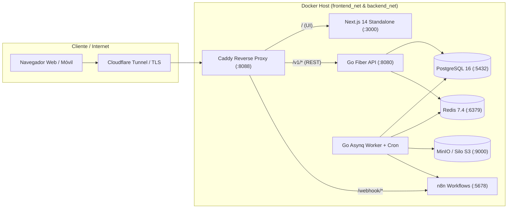

# Auditoría de Arquitectura, Seguridad y Plan de Implementación — Lubricentros Estrada S.A.C.

Este documento presenta el diagnóstico técnico integral de la infraestructura, el backend en Go, el esquema transaccional en PostgreSQL y el frontend en Next.js del ecosistema **Lubricentros Estrada**, identificando las vulnerabilidades críticas, cuellos de botella arquitectónicos y la hoja de ruta exacta para su remediación y paso a producción.

---

## 1. Mapa Actual de Arquitectura e Infraestructura



### Inventario de Componentes Analizados
- **Orquestación y Red**: [docker-compose.yml](file:///d:/jose/Lubricentro_Estrada/docker-compose.yml), [Caddyfile](file:///d:/jose/Lubricentro_Estrada/docker/caddy/Caddyfile), [backend/Dockerfile](file:///d:/jose/Lubricentro_Estrada/backend/Dockerfile), [frontend/Dockerfile](file:///d:/jose/Lubricentro_Estrada/frontend/Dockerfile).
- **Backend Core & Worker (Go 1.23)**: [cmd/api/main.go](file:///d:/jose/Lubricentro_Estrada/backend/cmd/api/main.go), [cmd/worker/main.go](file:///d:/jose/Lubricentro_Estrada/backend/cmd/worker/main.go), [config.go](file:///d:/jose/Lubricentro_Estrada/backend/internal/config/config.go), [handlers.go](file:///d:/jose/Lubricentro_Estrada/backend/internal/delivery/http/handlers.go), [sale_service.go](file:///d:/jose/Lubricentro_Estrada/backend/internal/service/sale_service.go), [sunat_service.go](file:///d:/jose/Lubricentro_Estrada/backend/internal/service/sunat_service.go), [reminder_worker.go](file:///d:/jose/Lubricentro_Estrada/backend/internal/worker/reminder_worker.go).
- **Persistencia (PostgreSQL 16)**: [001_init_schema.up.sql](file:///d:/jose/Lubricentro_Estrada/backend/migrations/001_init_schema.up.sql), [003_portal_and_products.up.sql](file:///d:/jose/Lubricentro_Estrada/backend/migrations/003_portal_and_products.up.sql).
- **Frontend (Next.js 14 App Router)**: [api.ts](file:///d:/jose/Lubricentro_Estrada/frontend/src/lib/api.ts), [ErpLayout.tsx](file:///d:/jose/Lubricentro_Estrada/frontend/src/components/admin/ErpLayout.tsx), [admin/login/page.tsx](file:///d:/jose/Lubricentro_Estrada/frontend/src/app/admin/login/page.tsx), [portal/page.tsx](file:///d:/jose/Lubricentro_Estrada/frontend/src/app/portal/page.tsx), [portal/dashboard/page.tsx](file:///d:/jose/Lubricentro_Estrada/frontend/src/app/portal/dashboard/page.tsx), [MapboxLocation.tsx](file:///d:/jose/Lubricentro_Estrada/frontend/src/components/premium/MapboxLocation.tsx).

---

## 2. Matriz de Vulnerabilidades Detectadas

> [!CAUTION]
> Se han identificado **5 vulnerabilidades críticas** que permiten saltar la autenticación administrativa, consultar datos de cualquier vehículo sin autorización (IDOR), usar contraseñas maestras hardcodeadas y manipular precios en el punto de venta.

| ID | Severidad | Capa | Archivo / Símbolo | Descripción del Riesgo |
| :--- | :---: | :---: | :--- | :--- |
| **VULN-01** | **CRÍTICA** | Backend API | [`RegisterRoutes`](file:///d:/jose/Lubricentro_Estrada/backend/internal/delivery/http/handlers.go#L32-L62) | **Endpoints administrativos sin autenticación**: `POST/PUT/DELETE /v1/products`, `POST /v1/sales` y `GET /v1/customers/:doc` carecen de middleware JWT/RBAC. Cualquier cliente HTTP puede modificar precios, borrar catálogo o emitir ventas. |
| **VULN-02** | **CRÍTICA** | Frontend / Auth | [`AdminLoginPage`](file:///d:/jose/Lubricentro_Estrada/frontend/src/app/admin/login/page.tsx#L25-L47), [`ErpLayout`](file:///d:/jose/Lubricentro_Estrada/frontend/src/components/admin/ErpLayout.tsx#L47-L55) | **Autenticación ERP 100% en cliente (Client-Side Bypass)**: La contraseña `"admin123"` está en el bundle JS y la sesión sólo comprueba si existe `localStorage.getItem("estrada_admin_token")`. Basta abrir la consola del navegador para entrar al ERP sin credenciales. |
| **VULN-03** | **CRÍTICA** | Backend Portal | [`PortalLogin`](file:///d:/jose/Lubricentro_Estrada/backend/internal/delivery/http/handlers.go#L443-L454), [`GetPortalVehicle`](file:///d:/jose/Lubricentro_Estrada/backend/internal/delivery/http/handlers.go#L613-L648) | **IDOR y Token Predecible en Portal de Clientes**: Los endpoints `/v1/portal/vehicle`, `/v1/portal/history` y `/v1/portal/maintenance/preventive` reciben `?plate=` sin validar el header `Authorization`. Además, el token emitido es un string predecible (`estrada_portal_<PLACA>_<UNIX>`) sin firma criptográfica. |
| **VULN-04** | **CRÍTICA** | Backend / DB | [`PortalLogin`](file:///d:/jose/Lubricentro_Estrada/backend/internal/delivery/http/handlers.go#L445), [`PortalRegister`](file:///d:/jose/Lubricentro_Estrada/backend/internal/delivery/http/handlers.go#L571) | **Contraseñas en texto plano y backdoor universal**: `PortalRegister` guarda `req.Password` en texto plano en `vehicles.password_hash`. `PortalLogin` acepta `"estrada123"` o `"1234"` para **cualquier vehículo** sin importar la contraseña del propietario. |
| **VULN-05** | **CRÍTICA** | Backend POS | [`CreateSale`](file:///d:/jose/Lubricentro_Estrada/backend/internal/service/sale_service.go#L146-L199) | **Manipulación de Precios (Price Tampering) y Stock Negativo**: `CreateSale` calcula el subtotal, IGV y total usando `item.UnitPrice` enviado desde el request JSON en vez del `sale_price` de la tabla `products`. Tampoco valida si `stockAfter < 0`. |
| **VULN-06** | **ALTA** | Infra / Docker | [docker-compose.yml](file:///d:/jose/Lubricentro_Estrada/docker-compose.yml#L130-L220) | **Exposición de servicios internos en el host**: PostgreSQL (`5432`), Redis sin contraseña (`6379`), MinIO (`9000/9001`) y n8n (`5678`) publican puertos en todas las interfaces (`0.0.0.0`) y `backend_net` tiene `internal: false`. |
| **VULN-07** | **ALTA** | Backend Config | [`LoadConfig`](file:///d:/jose/Lubricentro_Estrada/backend/internal/config/config.go#L26-L37) | **Secretos hardcodeados por defecto**: `JWT_SECRET`, `WEBHOOK_HMAC_SECRET` y credenciales de PostgreSQL tienen valores estáticos de respaldo en el código fuente. |
| **VULN-08** | **MEDIA** | Backend SQL | [`GetProducts`](file:///d:/jose/Lubricentro_Estrada/backend/internal/delivery/http/handlers.go#L119-L160) | **Bug en `technical_specs` y en paginación de placeholders SQL**: 1) `specs` se escanea en `[]byte` pero nunca se deserializa en `p.TechnicalSpecs` (siempre retorna vacío). 2) `string(rune('0'+argIdx))` falla si `argIdx >= 10` (genera carácteres ASCII inválidos). |
| **VULN-09** | **MEDIA** | Backend / Red | [`main.go`](file:///d:/jose/Lubricentro_Estrada/backend/cmd/api/main.go#L69-L73), [Caddyfile](file:///d:/jose/Lubricentro_Estrada/docker/caddy/Caddyfile#L6-L24) | **CORS comodín (`*`), ausencia de Rate Limiting y cabeceras HTTP**: Sin límite de peticiones por IP, `/v1/portal/auth/login` y `/v1/customers/:doc` permiten ataques de fuerza bruta y raspado (scraping) de clientes. |
| **VULN-10** | **MEDIA** | Frontend | [`MapboxLocation.tsx`](file:///d:/jose/Lubricentro_Estrada/frontend/src/components/premium/MapboxLocation.tsx#L12), [`api.ts`](file:///d:/jose/Lubricentro_Estrada/frontend/src/lib/api.ts#L73) | **Token Mapbox hardcodeado y RUC desactualizado en fallback**: El token público está fijo en código y el fallback offline de `submitSale` aún inyecta el RUC `20601234567` en la cadena QR en lugar de `20608945123`. |

---

## 3. Análisis Detallado de Mejoras Arquitectónicas (Backend & Frontend)

### 3.1. Mejoras en el Backend (Go + PostgreSQL + Asynq)
1. **Tabla de Usuarios Administrativos y RBAC (`users`)**:
   - Actualmente no existe una tabla `users` en PostgreSQL (las columnas `created_by UUID` en `sales` e `inventory_movements` no tienen clave foránea). Se debe crear la tabla `users` con roles (`ADMIN`, `CAJERO_POS`, `MECANICO_BAHIA`) y contraseñas hasheadas con `bcrypt` (coste 12).
2. **Desacoplamiento de Capas (Clean Architecture)**:
   - Aunque existen los paquetes `internal/repository` (`customer_repo.go`, `product_repo.go`, `vehicle_repo.go`) y `queries/*.sql` para `sqlc`, [`handlers.go`](file:///d:/jose/Lubricentro_Estrada/backend/internal/delivery/http/handlers.go) ejecuta consultas SQL crudas directamente contra `h.db`. Migrar estas consultas a la capa `repository` y `service` mejorará la testabilidad y el mantenimiento.
3. **Patrón Outbox Transaccional para Tareas Asíncronas (`sale_service.go`)**:
   - En [`CreateSale`](file:///d:/jose/Lubricentro_Estrada/backend/internal/service/sale_service.go#L312-L325), el encolado a Redis (`s.asynqClient.Enqueue`) ocurre dentro de una goroutine `go func()` **después** del `tx.Commit(ctx)` y descarta los errores (`_, _ =`). Si Redis cae un milisegundo después del commit, el comprobante queda en `PENDING` para siempre. Un barrido de recuperación en el worker cada 5 minutos para ventas `PENDING` con más de 2 minutos de antigüedad garantiza entrega 100% confiable (At-Least-Once Delivery).
4. **Caché Redis en el Catálogo Público (`/v1/products`)**:
   - Redis 7.4 está desplegado en Docker con 256 MB dedicados, pero sólo se usa para Asynq. Implementar caché `Cache-Aside` (TTL 5 minutos) en `GetProducts` e invalidación automática en `CreateProduct`/`UpdateProduct`/`DeleteProduct`/`CreateSale` reducirá la latencia de lectura del catálogo a `< 1 ms`.

### 3.2. Mejoras en el Frontend (Next.js 14 App Router)
1. **Conexión Real de todos los Módulos del ERP con PostgreSQL**:
   - Actualmente solo `/admin/products` y el envío final de `/admin/pos` interactúan con el backend. Los módulos `/admin/categories`, `/admin/crm`, `/admin/inventory`, `/admin/invoices` y `/admin` (Dashboard) usan datos estáticos en memoria (`useState`). Deben conectarse a endpoints REST reales (`/v1/categories`, `/v1/customers`, `/v1/inventory/movements`, `/v1/sales`, `/v1/analytics/dashboard`).
2. **Protección de Rutas en Servidor con Next.js Middleware (`src/middleware.ts`)**:
   - Reemplazar el chequeo tardío en `useEffect` (`localStorage`) por cookies `HttpOnly` verificadas en `src/middleware.ts`, redirigiendo en el servidor antes de enviar cualquier HTML de `/admin/*` o `/portal/dashboard`.
3. **Limpieza de Componentes Legacy Duplicados**:
   - Eliminar la carpeta obsoleta `frontend/src/components/landing/` (`Footer.tsx`, `Header.tsx`, `Hero.tsx`, `PlateChecker.tsx`, `ProductGrid.tsx`), ya que toda la portada utiliza `frontend/src/components/premium/`.
4. **Optimización de Carga de Video e Imágenes para Túneles y Redes Móviles**:
   - Configurar `Cache-Control: public, max-age=31536000, immutable` en Caddy para `/media/*` y `/_next/static/*`, añadir atributo `poster="/media/hero-car.png"` al `<video>` en [`Hero.tsx`](file:///d:/jose/Lubricentro_Estrada/frontend/src/components/premium/Hero.tsx#L26-L36) y habilitar optimización de imágenes en `next.config.mjs`.

---

## 4. Plan de Implementación Paso a Paso

### Fase 1: Hardening de Seguridad y Autenticación Real (Prioridad Inmediata)

#### 1.1. Migración SQL `004_security_and_erp_users.up.sql`
Crear la tabla de usuarios del ERP, añadir índices faltantes y migrar las contraseñas de vehículos a hashes `bcrypt`:

```sql
-- 1. Tabla de Usuarios Administrativos y Operadores POS
CREATE TABLE IF NOT EXISTS users (
    id UUID PRIMARY KEY DEFAULT gen_random_uuid(),
    email VARCHAR(150) UNIQUE NOT NULL,
    password_hash VARCHAR(255) NOT NULL,
    full_name VARCHAR(150) NOT NULL,
    role VARCHAR(30) NOT NULL DEFAULT 'ADMIN', -- 'ADMIN', 'CAJERO_POS', 'MECANICO'
    is_active BOOLEAN NOT NULL DEFAULT TRUE,
    last_login TIMESTAMPTZ,
    created_at TIMESTAMPTZ NOT NULL DEFAULT NOW()
);

-- Usuario oficial: admin@estrada.pe (Hash bcrypt de su contraseña corporativa)
INSERT INTO users (email, password_hash, full_name, role)
VALUES (
    'admin@estrada.pe',
    crypt('admin2026', gen_salt('bf', 12)),
    'Administración Estrada',
    'ADMIN'
) ON CONFLICT (email) DO NOTHING;

-- 2. Hashear contraseñas en texto plano existentes en vehicles usando pgcrypto
UPDATE vehicles
SET password_hash = crypt(password_hash, gen_salt('bf', 10))
WHERE password_hash NOT LIKE '$2a$%' AND password_hash NOT LIKE '$2b$%';
```

#### 1.2. Implementación de JWT y Middleware RBAC en Go
Crear `backend/internal/delivery/http/middleware.go`:
- Emitir tokens **JWT firmados con HMAC-SHA256** (`golang-jwt/jwt/v5`) tanto en `POST /v1/admin/auth/login` (con claims `user_id`, `email`, `role`) como en `POST /v1/portal/auth/login` (con claims `vehicle_id`, `license_plate`, `customer_id`).
- En [`GetPortalVehicle`](file:///d:/jose/Lubricentro_Estrada/backend/internal/delivery/http/handlers.go#L613), [`GetPortalHistory`](file:///d:/jose/Lubricentro_Estrada/backend/internal/delivery/http/handlers.go#L650) y [`GetPortalPreventive`](file:///d:/jose/Lubricentro_Estrada/backend/internal/delivery/http/handlers.go#L692), extraer la placa directamente de los claims del JWT validado (o verificar que `claims.LicensePlate == cleanPlate`), erradicando por completo la vulnerabilidad **IDOR (VULN-03)**.
- Eliminar `"estrada123"` y `"1234"` como comodines en [`PortalLogin`](file:///d:/jose/Lubricentro_Estrada/backend/internal/delivery/http/handlers.go#L445) y usar `bcrypt.CompareHashAndPassword` (**VULN-04**).

#### 1.3. Corrección de Integridad Financiera y de Catálogo en Backend
- **En [`CreateSale`](file:///d:/jose/Lubricentro_Estrada/backend/internal/service/sale_service.go#L150-L185)**:
  - Consultar `stock_current, purchase_price, sale_price, unit_code` desde la tabla `products`.
  - Validar `if currentStock.LessThan(item.Quantity)` para impedir quiebres de stock negativos (o permitirlo sólo si el producto es un servicio).
  - Usar el `sale_price` de la base de datos como fuente de verdad (permitiendo descuento sólo si el rol es `ADMIN` y dentro de un umbral autorizado).
- **En [`GetProducts`](file:///d:/jose/Lubricentro_Estrada/backend/internal/delivery/http/handlers.go#L120-L160)**:
  - Reemplazar `string(rune('0'+argIdx))` por `strconv.Itoa(argIdx)`.
  - Deserializar `specs` antes de agregar el producto a la lista:
    ```go
    if len(specs) > 0 {
        _ = json.Unmarshal(specs, &p.TechnicalSpecs)
    }
    ```

---

### Fase 2: Blindaje de Infraestructura, Docker y Caddy

#### 2.1. Aislamiento de Red en [docker-compose.yml](file:///d:/jose/Lubricentro_Estrada/docker-compose.yml)
- Remover la publicación de puertos al exterior (`ports:`) en `postgres`, `redis`, `minio`, `api` y `n8n` (o vincularlos exclusivamente a `127.0.0.1:5432:5432` para desarrollo local), dejando únicamente a `caddy` (`8088:80`, `8443:443`) como punto de entrada.
- Habilitar autenticación en Redis: `--requirepass ${REDIS_PASSWORD}`.
- Cambiar `SUNAT_RUC` por defecto en [`config.go`](file:///d:/jose/Lubricentro_Estrada/backend/internal/config/config.go#L35) a `20608945123`.

#### 2.2. Cabeceras de Seguridad y Caché en [Caddyfile](file:///d:/jose/Lubricentro_Estrada/docker/caddy/Caddyfile)
```caddyfile
:80 {
    encode zstd gzip

    header {
        X-Content-Type-Options "nosniff"
        X-Frame-Options "SAMEORIGIN"
        Referrer-Policy "strict-origin-when-cross-origin"
        Permissions-Policy "geolocation=(self), microphone=(), camera=()"
        -Server
    }

    @static_media path /media/* /_next/static/*
    header @static_media Cache-Control "public, max-age=31536000, immutable"

    handle /v1/* {
        reverse_proxy api:8080
    }

    handle {
        reverse_proxy web:3000
    }
}
```

---

### Fase 3: Integración Full-Stack del ERP y Mejoras en Frontend

#### 3.1. Nuevos Endpoints REST para el ERP en `handlers.go`
Implementar y conectar con la base de datos:
1. `POST /v1/admin/auth/login` — Autenticación de administradores y cajeros contra la tabla `users`.
2. `POST /v1/categories` y `PUT /v1/categories/:id` — Persistencia real para el módulo [admin/categories/page.tsx](file:///d:/jose/Lubricentro_Estrada/frontend/src/app/admin/categories/page.tsx).
3. `GET /v1/sales` y `GET /v1/sales/:id` — Listado paginado de comprobantes emitidos y estado SUNAT (`ACCEPTED`, `PENDING`, `REJECTED`) para [admin/invoices/page.tsx](file:///d:/jose/Lubricentro_Estrada/frontend/src/app/admin/invoices/page.tsx).
4. `GET /v1/customers` y `POST /v1/customers` — Directorio CRM con vehículos vinculados para [admin/crm/page.tsx](file:///d:/jose/Lubricentro_Estrada/frontend/src/app/admin/crm/page.tsx) y selector dinámico en [`CustomerSection.tsx`](file:///d:/jose/Lubricentro_Estrada/frontend/src/components/pos/CustomerSection.tsx).
5. `GET /v1/inventory/movements` y `POST /v1/inventory/adjustments` — Movimientos Kardex reales para [admin/inventory/page.tsx](file:///d:/jose/Lubricentro_Estrada/frontend/src/app/admin/inventory/page.tsx).
6. `GET /v1/analytics/dashboard` — KPIs en tiempo real (total facturado del mes, ventas por día para Recharts, top lubricantes vendidos y alertas de stock mínimo) para [admin/page.tsx](file:///d:/jose/Lubricentro_Estrada/frontend/src/app/admin/page.tsx).

#### 3.2. Correcciones Puntuales en Frontend
- **Middleware de Protección (`frontend/src/middleware.ts`)**: Validar cookie de sesión antes de renderizar rutas bajo `/admin` (excepto `/admin/login`) y `/portal/dashboard`.
- **Variables de Entorno y RUC ([`MapboxLocation.tsx`](file:///d:/jose/Lubricentro_Estrada/frontend/src/components/premium/MapboxLocation.tsx#L12) y [`api.ts`](file:///d:/jose/Lubricentro_Estrada/frontend/src/lib/api.ts#L73))**:
  - Mover el token de Mapbox a `process.env.NEXT_PUBLIC_MAPBOX_TOKEN`.
  - Actualizar el RUC en el QR de contingencia de [`api.ts`](file:///d:/jose/Lubricentro_Estrada/frontend/src/lib/api.ts#L73) a `20608945123`.
- **Sincronización del Catálogo POS ([`admin/pos/page.tsx`](file:///d:/jose/Lubricentro_Estrada/frontend/src/app/admin/pos/page.tsx))**: Cargar los productos del POS directamente desde `fetchProducts()` (`/v1/products`) con fallback al catálogo local, asegurando que todo producto nuevo creado en `/admin/products` aparezca de inmediato en la terminal de cobro con su stock real.
- **Eliminación de Código Muerto**: Borrar el directorio `frontend/src/components/landing/`.

---

## 5. Cronograma de Ejecución Recomendado

| Etapa | Entregable | Archivos Impactados |
| :--- | :--- | :--- |
| **Paso 1** | Migración `004`, hashing `bcrypt`, corrección de `GetProducts` (`technical_specs` y `strconv.Itoa`) y validación de precios/stock en `CreateSale`. | `004_security_and_erp_users.up.sql`, `handlers.go`, `sale_service.go` |
| **Paso 2** | Autenticación JWT + Middleware RBAC para `/v1/admin/*` y protección anti-IDOR en `/v1/portal/*` + Rate Limiter en Fiber. | `cmd/api/main.go`, `handlers.go`, `middleware.go` |
| **Paso 3** | Endpoints del ERP (`categories`, `customers`, `sales`, `inventory/movements`, `analytics/dashboard`) y conexión con las vistas de `/admin/*`. | `handlers.go`, `admin/page.tsx`, `admin/categories/page.tsx`, `admin/crm/page.tsx`, `admin/invoices/page.tsx`, `admin/inventory/page.tsx`, `admin/pos/page.tsx` |
| **Paso 4** | Hardening de `docker-compose.yml`, cabeceras de seguridad/caché en `Caddyfile`, limpieza de `components/landing/` y actualización de `api.ts`. | `docker-compose.yml`, `Caddyfile`, `api.ts`, `MapboxLocation.tsx` |
